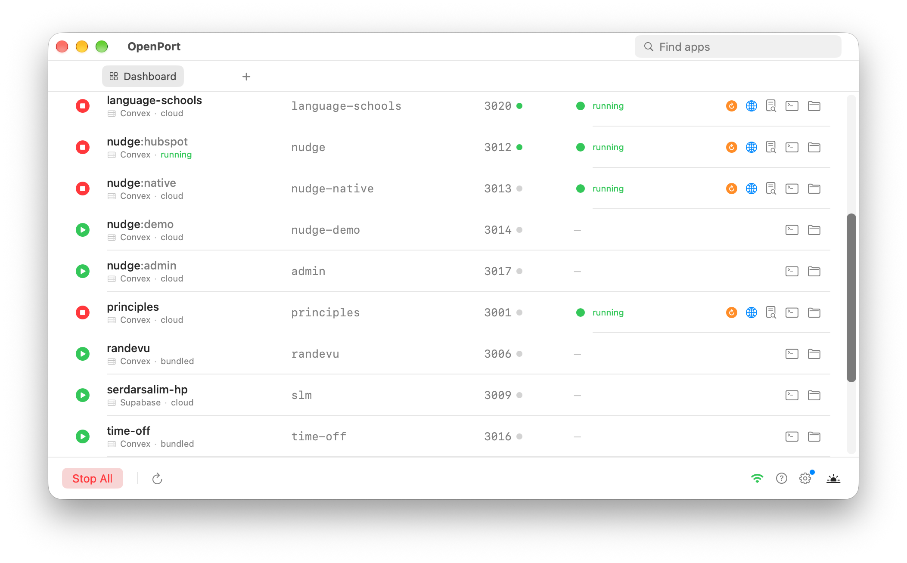

# OpenPort

A free Mac app that starts and stops all your local dev servers from one window. No terminal juggling, no remembering ports.

Point it at your projects folder. Every project with a `dev` script shows up. Click play.



**[Download for macOS](https://github.com/serdarsalim/openport/releases/latest/download/openport-macos.zip)** · [Website](https://serdarsalim.com/openport) · [Full guide](docs/guide.md)

## What you get

- One-click start and stop for every project, with the port it's on
- Sees servers you started elsewhere too, and can stop them cleanly
- Live status, logs and built-in terminal tabs for each project
- QR code to open a project on your phone, plus a menu bar launcher

Works with Next.js, Vite, Nuxt, Express, Remix, Convex and anything else that runs on `npm run dev`. Needs macOS 14+ and Node.js.

The app isn't signed with a paid Apple certificate, so the first time you open it, right-click it and choose **Open**.

## Build from source

```bash
git clone https://github.com/serdarsalim/openport.git
cd openport
./build-app.sh
open dist/OpenPort.app
```

## License

[AGPL-3.0](LICENSE)
